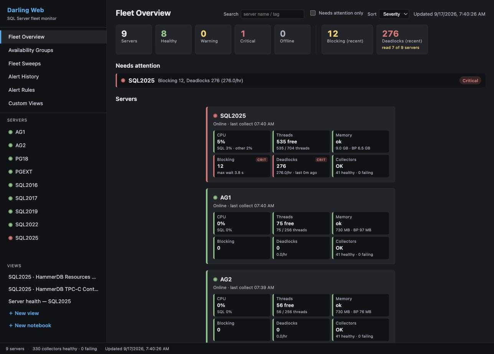

# SQL Server Performance Monitor

  
  
  
  

Free, open-source monitoring that replaces the tools charging you thousands per server per year. It includes specialized collectors, real-time alerts, and a built-in MCP server for AI analysis. Nothing phones home. Your data stays on your server and your machine.

If you pay for a monitoring tool now, read the comparison for yours.

[Redgate SQL Monitor](https://erikdarling.com/redgate-sql-monitor-renewal-free-alternative/) · [SQL Sentry](https://erikdarling.com/solarwinds-sql-sentry-renewal-free-alternative/) · [SolarWinds DPA](https://erikdarling.com/solarwinds-dpa-renewal-free-alternative/) · [Idera SQL Diagnostic Manager](https://erikdarling.com/idera-sql-diagnostic-manager-renewal-free-alternative/) · [Quest Spotlight](https://erikdarling.com/your-quest-spotlight-on-sql-server-enterprise-renewal-is-coming-up-heres-what-free-looks-like-in-2026/) · [Datadog Database Monitoring](https://erikdarling.com/datadog-database-monitoring-cost-free-alternative/) · [Database Health Monitor](https://erikdarling.com/database-health-monitor-renewal-free-alternative/)

It supports SQL Server 2016 SP2 to 2025. SQL Server 2017 needs CU3 or later. It also supports Azure SQL Managed Instance, AWS RDS for SQL Server, and Azure SQL Database (Lite and Darling). Darling also monitors PostgreSQL. It supports PostgreSQL 14 to 18, plus Amazon RDS, Aurora and Azure Database for PostgreSQL, and makes a best effort on PostgreSQL 10 to 13. See [Supported PostgreSQL versions](docs/darling/postgresql-targets.md#supported-postgresql-versions).

## Editions

- **Lite** is a single desktop app that monitors your servers remotely, on demand. Nothing is installed on your server. It stores data in local DuckDB and Parquet files.
- **Darling** is a service on Windows or Linux that collects 24/7 into a central PostgreSQL store. The Windows viewer and the web dashboard read that store from any seat.

Both editions can hand an alert to an AI agent that you run, and Lite lets the agent read and report. Darling can also let it change alert settings (mutes, custom alert rules and thresholds). On a server, it can force or unforce a Query Store plan or evict a cached plan. It can recompile a module, create or drop a plan guide, or kill a session. Each of these has its own switch per server, and all are off until you turn them on. Darling records every change. A person can undo alert-setting changes, plan forces and plan guide changes. A plan eviction, a recompile or a session kill cannot be undone. [Agent dispatch](docs/darling-agent-dispatch.md) explains the levels.

The Dashboard edition is deprecated. Existing installs keep working, but we recommend Lite or Darling for new deployments. [Choosing an edition](docs/editions.md) compares all three.

Each release ships these downloads. For Lite, a `Setup.exe` and a portable ZIP. For Darling, the service ZIP (with the viewer inside), a Viewer `Setup.exe` for a remote seat, and the Linux and Compose tarballs. The Full Dashboard and its CLI installer ship nothing. Their last builds are in the [v3.2.0 release](https://github.com/erikdarlingdata/PerformanceMonitor/releases/tag/v3.2.0).

Not sure which one? Start with Lite. It is one download, nothing is installed on your server, and data starts to flow in under 5 minutes.

## Quick start: Lite

1. Download [`PerformanceMonitorLite-lite-Setup.exe`](https://github.com/erikdarlingdata/PerformanceMonitor/releases/latest). It is a self-contained build, so you do not install a .NET runtime first.
2. Run the installer. It adds Start Menu and Desktop shortcuts.
3. Start Lite from the Start Menu or the Desktop shortcut.
4. Click **+ Add Server**, enter the connection details, test, and save.
5. Double-click the server in the sidebar to connect.

Data starts to flow within 1 to 5 minutes. The monitoring login needs `VIEW SERVER STATE` ([Permissions](docs/permissions.md)).

Before you upgrade an older install with `Setup.exe`, read the warning in the [Lite guide](docs/lite-guide.md). On versions older than 3.4.0, `Setup.exe` deletes the data in the install directory (see [Upgrading an install older than 3.4.0](docs/lite-guide.md#upgrading-an-install-older-than-340)). The Lite guide also covers the portable ZIP, collectors, storage, and configuration.

## Quick start: Darling

1. Download `PerformanceMonitorDarling-<version>.zip` and `SHA256SUMS.txt` from the [latest release](https://github.com/erikdarlingdata/PerformanceMonitor/releases/latest). Check the zip hash against `SHA256SUMS.txt`. The zip carries its own .NET runtime, so there is nothing to install first.
2. Extract the zip to `C:\Program Files\PerformanceMonitorDarling`. Do not use your Desktop, Downloads, or any folder under `C:\Users\`. The service runs as a virtual account that cannot read a user profile ([why](docs/darling/install.md#step-3-extract-to-a-machine-scoped-path)).
3. Double-click `Install-Darling.cmd` in the install folder. It asks Windows for administrator rights and runs `install-darling.ps1`. You can also run `.\install-darling.ps1` from an elevated PowerShell. It installs the Windows service and creates a **Darling Viewer** shortcut. With no `darling.json` it writes a minimal one, and the service starts with no monitored servers.
4. Wait about two minutes for the first start, then open **Darling Viewer**. It opens on the fleet.
5. Add your first server in the viewer. `darling.json` is only a seed. The service reads it on its first start, so a server added to the file later is ignored ([why](docs/darling/install.md#darlingjson-is-only-a-seed)).
6. The service log is in `%ProgramData%\PerformanceMonitorDarling\logs`.

[Install Darling](docs/darling/install.md) gives each step with the log line or screen that proves it worked. To upgrade, run `upgrade-darling.ps1`. To remove the service, run `uninstall-darling.ps1`. Both are in the install folder. For Linux and the web dashboard, read the [Darling quick start](docs/darling-quick-start.md). The [Darling operator guide](Darling/README.md) is the configuration reference.

## Documentation

| Page | What it covers |
|---|---|
| [Choosing an edition](docs/editions.md) | Lite, Darling, and Dashboard side by side |
| [Features and screenshots](docs/features.md) | What you get, with screenshots |
| [Lite guide](docs/lite-guide.md) | Install, upgrade, where Lite keeps its files, configuration, appearance, collectors |
| [Lite Extended Events sessions](docs/lite-extended-events.md) | The sessions Lite creates on a monitored server, and how to remove them |
| [Darling quick start](docs/darling-quick-start.md) | Install on Windows, Linux notes, web dashboard |
| [Darling operator guide](Darling/README.md) | Darling configuration, permissions, operations |
| [Darling store sizing](docs/darling-store-sizing.md) | Disk, RAM and vCPU for a store host, by number of servers |
| [Back up, restore and move the store](docs/darling-store-backup.md) | Back up a Darling store, restore it, or move it to another machine |
| [Darling guides](docs/darling/README.md) | Install, viewer, web dashboard, MCP, day-to-day admin and command line reference |
| [PostgreSQL target runbook](docs/postgres-first-target-runbook.md) | Point Darling at a PostgreSQL target, with a proof point at each step |
| [Retention Held runbook](docs/retention-hold-runbook.md) | Clear a Retention Held alert |
| [How collection works](docs/how-collection-works.md) | A tour of the collection pipeline, for people who read the code |
| [Documentation index](docs/README.md) | Every page in `docs/`, grouped by audience |
| [Tabs](docs/tabs.md) | What each tab shows |
| [Alerts and notifications](docs/alerts.md) | Alert types, channels, routes, email |
| [Agent dispatch](docs/darling-agent-dispatch.md) | Hand an alert to your own AI agent: levels, the brief and report, undo, the remediation login |
| [Signed webhooks](docs/signed-webhooks.md) | Verify that a generic webhook post came from Darling |
| [Agent job monitoring](docs/agent-job-monitoring.md) | Running SQL Agent jobs and jobs that run longer than expected |
| [MCP server](docs/mcp-server.md) | Setup, the tool list and the Lite investigation tools for AI analysis |
| [Authentication](docs/authentication.md) | Authentication types and credential profiles |
| [Permissions](docs/permissions.md) | Grants for on-premises, Azure, and AWS RDS. The optional agent remediation login is in [Agent dispatch](docs/darling-agent-dispatch.md#the-remediation-login) |
| [Platform notes](docs/platform-notes.md) | AWS RDS and Aurora configuration |
| [Performance impact](docs/performance-impact.md) | Load on monitored servers, and local resources for Lite |
| [Troubleshooting](docs/troubleshooting.md) | Common problems for Lite and Darling |
| [Building from source](docs/building-from-source.md) | Folder structure and build commands |
| [Support and sponsorship](docs/support.md) | Commercial support tiers and sponsorship |
| [Third-party components](docs/third-party-components.md) | Third-party components and their licenses |
| [Changelog](CHANGELOG.md) | Changes in each release |

## Support

Performance Monitor is free and open source under the MIT License, with no features withheld. The tools that it replaces charge thousands of dollars per server per year. A support subscription covers all of your SQL Server instances.

| Tier | Cost per year | Email response | Includes |
|------|---------------|----------------|----------|
| **Supported** | $500 | Within 2 business days | Guaranteed compatibility updates for new SQL Server versions, priority feature requests, a support agreement and invoices, unlimited instances |
| **Priority** | $2,500 | By the next business day | Everything in Supported, plus a quarterly live Q&A session, early access to new features, and direct input on the roadmap |

[Support and sponsorship](docs/support.md) says what support gets you and has the link to buy. You can also [sponsor on GitHub](https://github.com/sponsors/erikdarlingdata).

## Sponsors

<table>
  <tr>
    <td></td>
    <td>Free code signing on Windows provided by <a href="https://signpath.io">SignPath.io</a>, certificate by <a href="https://signpath.org">SignPath Foundation</a></td>
  </tr>
</table>

## License

Copyright (c) 2026 Darling Data, LLC. Licensed under the MIT License. See [LICENSE](LICENSE) for details.

## Author

Erik Darling: [erikdarling.com](https://erikdarling.com) and [Darling Data, LLC](https://darlingdata.com)
