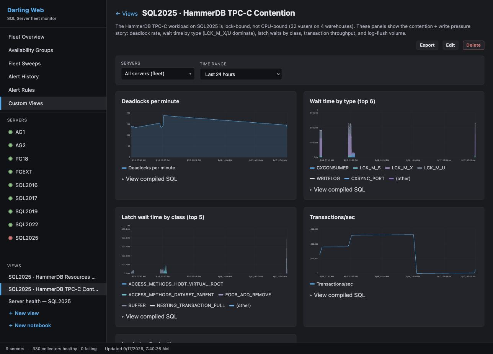
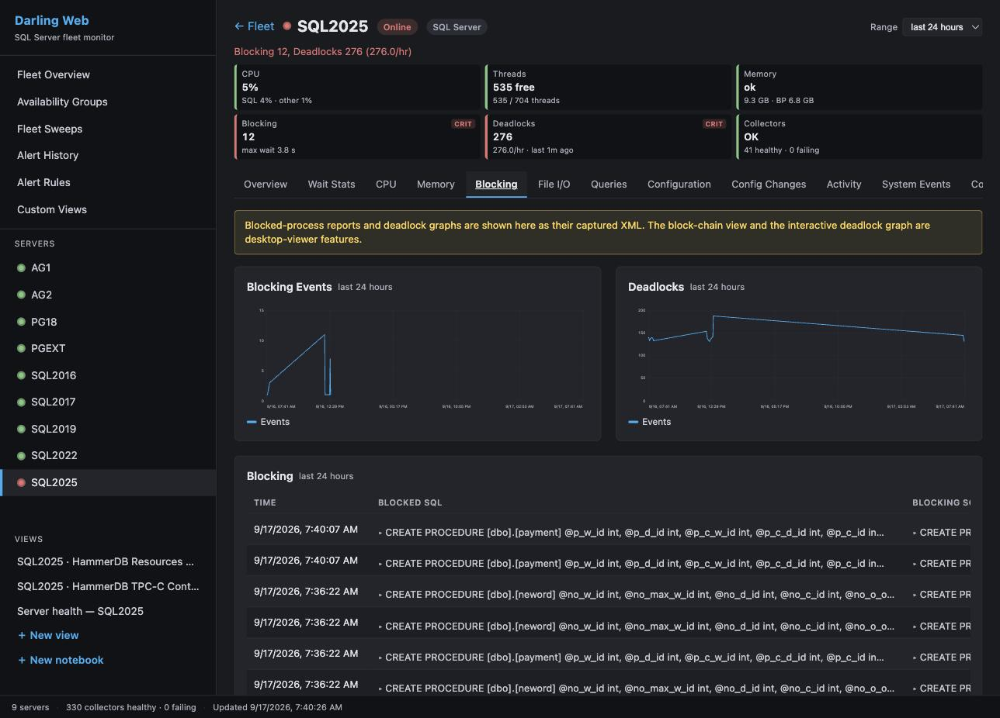
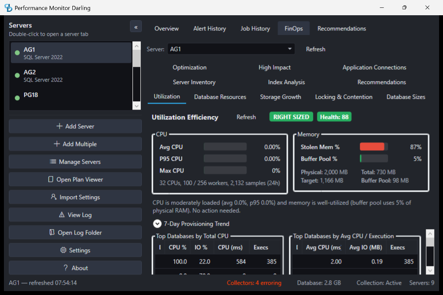
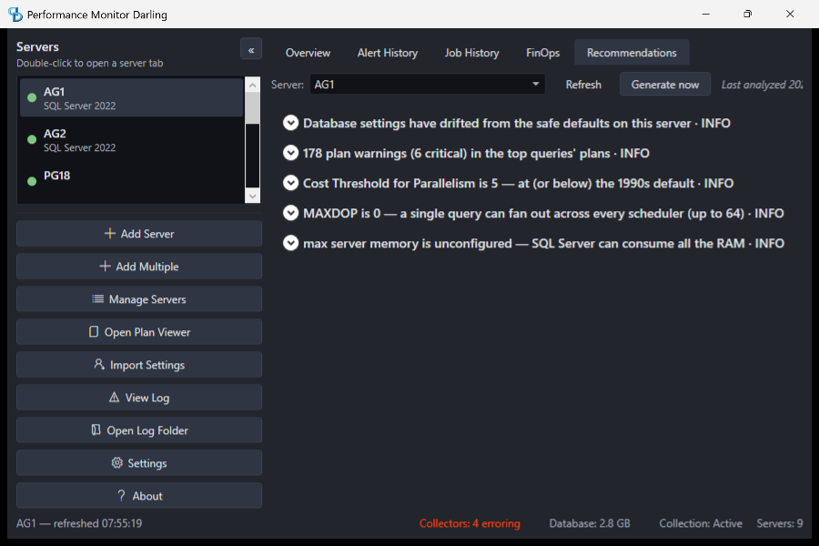
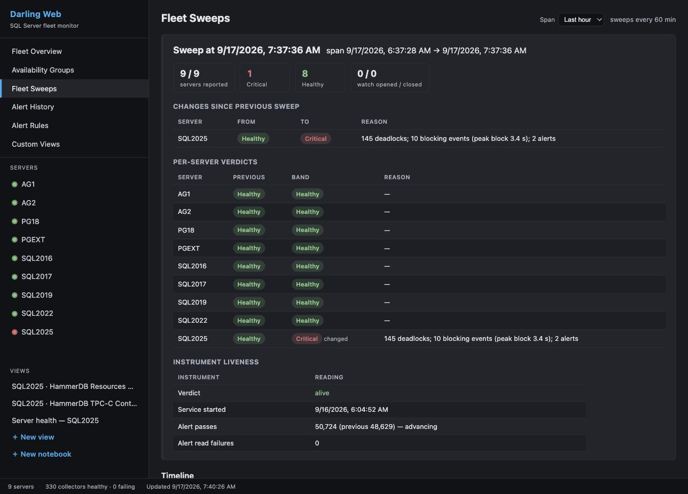
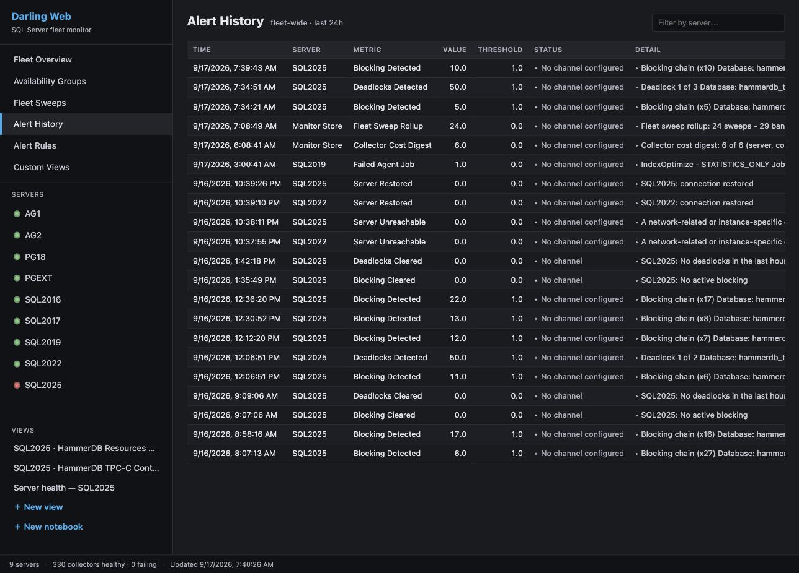

# Features and screenshots

Audience: operators.

Part of the [Performance Monitor documentation](../README.md#documentation).

## What You Get

🔍 **Specialized collectors** on configurable schedules — wait stats, query performance, blocking chains, deadlock graphs, memory grants, file I/O, tempdb, perfmon counters, FinOps/capacity, and more. You can turn each collector off on its own. Darling also has one `capturePlans` setting in `darling.json`, on by default, that stops execution plan capture for every server.

🚨 **Real-time alerts** for blocking, deadlocks, high CPU, low disk space, and the other conditions listed in [Alerts & Notifications](alerts.md) — system tray notifications, styled HTML emails with full XML attachments, and webhook notifications for external integrations

📊 **NOC-style overview** with green/yellow/red health cards, auto-refresh, configurable time ranges, and Dark, Light and Cool Breeze themes

📋 **Graphical plan viewer** with native ShowPlan rendering, 37-rule PlanAnalyzer, operator-level cost breakdown, and a standalone mode for opening `.sqlplan` files without a server connection

💡 **Recommendations engine (advise-and-act)** — a dedicated Recommendations tab surfaces prioritized findings from your own monitoring data with the reasoning behind each one, and can apply selected fixes directly. Destructive changes (like enabling Read Committed Snapshot Isolation) are gated behind an informed-consent dialog that spells out both the risk of acting and the risk of doing nothing.

🤖 **Built-in MCP server** with read-only tools for AI analysis — ask Claude Code or Cursor "what are the top wait types on my server?" and get answers from your actual monitoring data

🔒 **Your data never leaves** — no telemetry, no cloud dependency, no phoning home. Credentials stored in Windows Credential Manager with OS-level encryption. Statement text that can carry a credential, such as `CREATE LOGIN` or a `PASSWORD =` literal, reads `-- statement text withheld (#4348)` in alerts and plan analysis. Darling also withholds it from collected data, MCP answers and web pages.

## More Screenshots

### Custom dashboards — compose any metric into a chart

### Blocking & deadlocks

### FinOps — right-sizing & cost analysis

### Recommendations — advise and act

### Fleet Sweeps — scheduled fleet-wide health with memory

### Graphical Plan Viewer

### Alert History

### MCP Server — AI-Powered Analysis

## What People Are Saying

> *"You guys make us DBAs look like absolute rockstars. I'm over here getting showered with praise, and all I do is use your scripts and follow your advice."*

> *"replaced SentryOne and had it running in 10 minutes"*

> *"I've had enough time to gather data and converse with Claude on this. It helped a lot to zone in on CPU starvation from the hypervisor on which the VM runs. IT team currently investigating the host configuration."*
